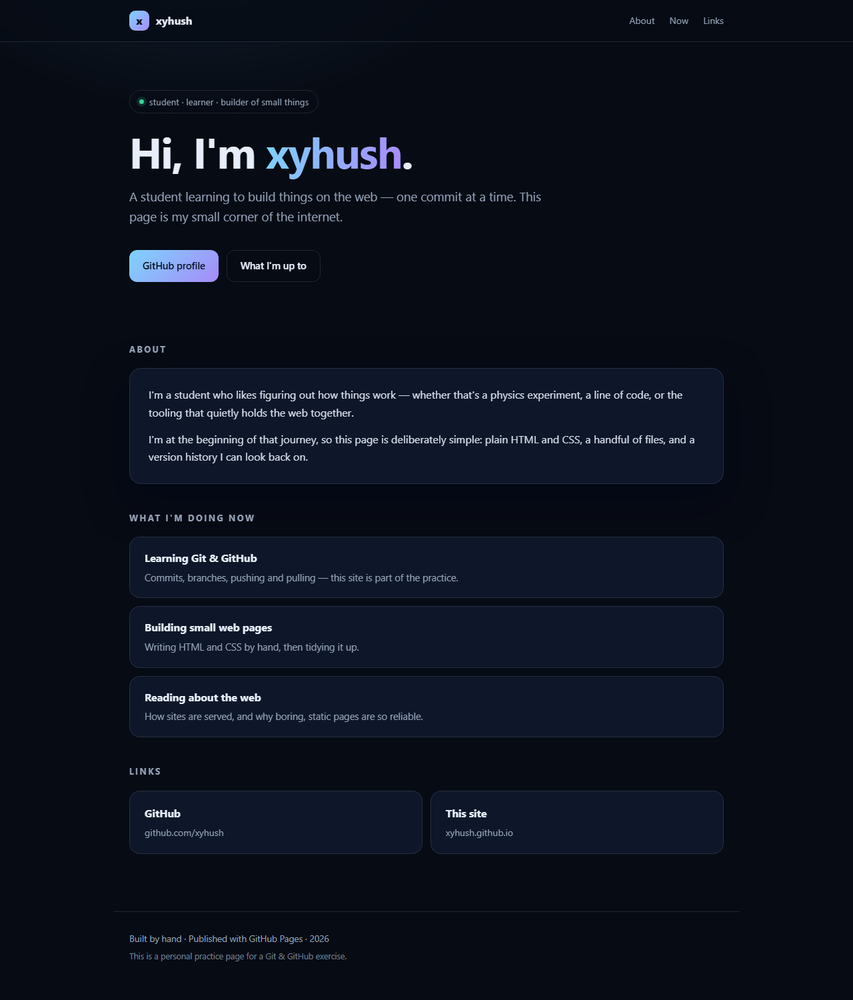

# github_homepage — personal site preview

A one-page personal website, published with **GitHub Pages**.

| | |
|---|---|
| **Live site** | https://xyhush.github.io/ |
| **Repository** | https://github.com/xyhush/xyhush.github.io |
| **Branch** | `main` (site files served from the repository root) |



## What it is

A single static page introducing me — who I am, what I'm working on right now,
and where to find me. Written by hand in plain HTML and CSS: no framework, no
build step, nothing to install.

Sections:

- **Hero** — a short greeting and one-line introduction
- **About** — a couple of sentences about how I'm learning
- **Now** — what I'm currently spending time on
- **Links** — GitHub profile and this site

## Files

```
index.html    the page itself
style.css     all styling (dark theme by default, light theme via prefers-color-scheme)
preview.png   a screenshot of the live page
README.md     this preview
```

## How it is published

1. Repository is named `xyhush.github.io` and is **public** (required on GitHub Free).
2. `index.html` sits at the repository **root**.
3. GitHub Pages builds automatically from `main` / root on every push.

## Privacy

The page uses a nickname only. It contains no student ID, no personal documents
and no private course material.

## Note on AI assistance

The page was drafted with AI help (structure and CSS) and then reviewed and
published by me; I checked the live result myself.
